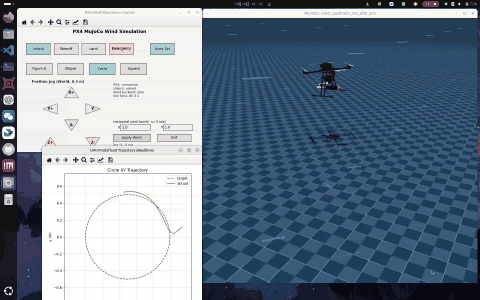
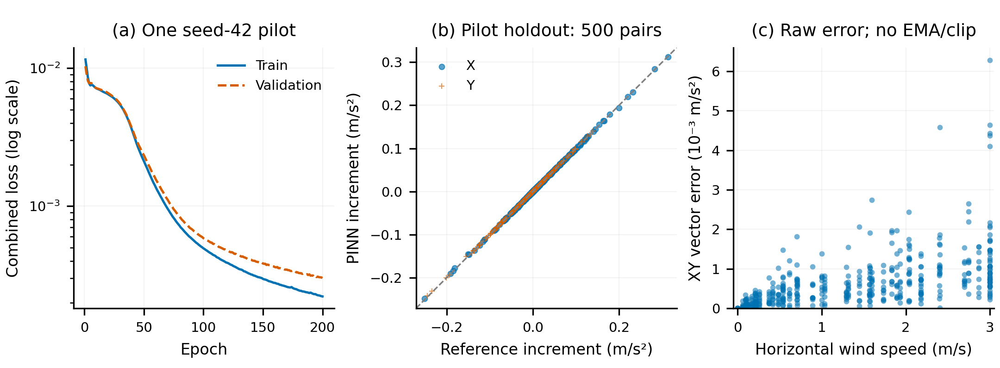

# Wind Field Simulation

[简体中文](README.md) | **English**

A MuJoCo and PX4 SITL simulation project for testing quadrotor stability and
trajectory tracking with and without wind disturbances. It includes an X4-950
quadrotor with an Airbot Play arm, scene assets, an interactive control panel,
configurable horizontal wind and predefined trajectories.

The default aerodynamic backend is the new X4-950 `pinn-x4` surrogate. The
independent analytical reference and the legacy PINN remain explicit fallback
options. PX4 retains its native flight controllers.

## Demo

| X4-950 + Airbot Play model | Interactive control panel |
| --- | --- |
|  |  |

| Demo video (animated preview) | Circular trajectory tracking example |
| --- | --- |
| [](docs/media/videos/Wind%20field%20simulation%20Demo.mp4) |  |
| [Watch / download the full MP4 (approximately 86 seconds, 17.6 MB)](docs/media/videos/Wind%20field%20simulation%20Demo.mp4) | Dashed gray: target; red: actual trajectory |

The left cell shows a 12-second GIF preview from 00:48–01:00 of the original
recording (4 fps, silent). Click it to open the full MP4.

These materials demonstrate features. The screenshots do not specify complete
experimental conditions and do not establish aerodynamic accuracy or quantitative
closed-loop performance. The full video link opens its GitHub file page; download it
if inline playback is unavailable.

Start with the **[complete installation guide](docs/INSTALL.en.md)** for system
dependencies, tested versions, environment checks and troubleshooting.
[中文安装说明](docs/INSTALL.zh-CN.md) is also available. Detailed research reports
retain their original languages; this README and the installation guide are bilingual.

## Project structure

```text
Wind_field_simulation/
├── src/
│   ├── wind_field_simulation/
│   │   ├── simulation.py          # Simulation, MAVLink, control panel and wind
│   │   ├── wind_backends.py       # New PINN and analytical runtime adapters
│   │   ├── training/             # Reference, paired sampling, training, evaluation
│   │   ├── _vendor/              # Legacy PINN, Normalizer and RotorPy parameters
│   │   └── assets/
│   │       ├── scenes/default/   # Main scene XML
│   │       ├── robot_models/     # Quadrotor, arm, meshes and textures
│   │       ├── checkpoints/      # New checkpoint/reference and legacy weights
│   │       └── configs/          # X4-950.params
│   └── pymavlink/                # Bundled protocol library
├── third_party/PX4-Autopilot/    # Local development only; omitted from GitHub
├── runtime/px4/                 # Prebuilt SITL executable and startup resources
├── scripts/                     # Simulation, SITL and source build entry points
├── tests/                       # Offline regression tests
├── docs/                        # Installation, experiments and provenance
├── licenses/                    # Third-party licenses
├── outputs/                     # Generated logs and experiment outputs; ignored
├── pyproject.toml
└── requirements.txt
```

## Environment

The tested host is Ubuntu 24.04.5 LTS, x86-64, glibc 2.39 and Python 3.12.13.
Core Python dependencies are MuJoCo **3.6.0**, NumPy **2.4.4**, PyTorch **2.11.0**
and Matplotlib **3.10.9**. See the [dependency table](docs/INSTALL.en.md#dependency-versions-and-validation-boundaries)
for native libraries and additional declared dependencies. GPU/CUDA is not required.

After cloning and installing the system libraries in the installation guide:

```bash
cd ~/Wind_field_simulation
python3.12 -m venv .venv
source .venv/bin/activate
python -m pip install --upgrade pip
python -m pip install torch==2.11.0 --index-url https://download.pytorch.org/whl/cpu
python -m pip install -e '.[dev]'
```

Use an isolated environment: the project installs its bundled `pymavlink`.
Only the RotorPy Hummingbird parameters needed for the legacy model are bundled;
the full RotorPy package is unnecessary. These parameters preserve the legacy
input contract and do not describe the X4-950. The new backend uses its own
XML-derived reference.

On the original development machine, the existing Conda environment `env_uav`
can be used instead. Its explicit activation commands are included below.

## Start the simulation

The first public version includes the application, models, weights, frozen
reference and prebuilt **PX4 SITL runtime** under `runtime/px4/bin/` and `etc/`.
It omits the large PX4 source tree, build caches and experiment outputs. The
complete local development source tree is retained.

The runtime targets **Linux x86-64** and requires matching native libraries,
including Gazebo Transport 13, Gazebo Messages 10 and Protobuf. Run
`ldd runtime/px4/bin/px4` and resolve every missing library before launching.
The [installation guide](docs/INSTALL.en.md) provides the Ubuntu 24.04 procedure;
[PX4 documentation](docs/px4.md) records source provenance and build requirements.
Other platforms require matching sources and a separate build.

Open two terminals. If an earlier instance is still running, stop it with
`Ctrl+C` in its own terminal first.

### Terminal 1: PX4 SITL

```bash
cd ~/Wind_field_simulation
source .venv/bin/activate
bash scripts/run_px4_sitl.sh
```

Keep it running while starting terminal 2. PX4 waits for the simulator connection.

### Terminal 2: MuJoCo and control panel

```bash
cd ~/Wind_field_simulation
source .venv/bin/activate
python scripts/run_simulation.py
```

This loads **`pinn-x4`** and its bundled checkpoint/reference automatically.
To choose a fallback, replace only the last command in terminal 2:

```bash
python scripts/run_simulation.py --wind-backend analytic
# Or use the legacy PINN:
python scripts/run_simulation.py --wind-backend pinn
```

On the original development machine, use the following complete commands instead:

```bash
# Terminal 1
source /home/raids/miniconda3/etc/profile.d/conda.sh
conda activate env_uav
cd /home/raids/Wind_field_simulation
bash scripts/run_px4_sitl.sh
```

```bash
# Terminal 2
source /home/raids/miniconda3/etc/profile.d/conda.sh
conda activate env_uav
cd /home/raids/Wind_field_simulation
python scripts/run_simulation.py
```

Initial wind inputs are empty and the wind toggle is disabled. Enter both
horizontal components and click **Apply Wind** before enabling wind. CLI options
`--wind-x` / `--wind-y` only prefill a draft; they do not apply or enable it.
When either is provided, an unspecified horizontal component defaults to zero.
Wind Z is fixed at zero; `--wind-z` is not supported.

The default ports are TCP **4560** and Offboard UDP **14580**. The launcher sets
`PX4_SIM_MODEL=none_iris` and `PX4_SIM_FLOAT_STATE=1` and writes runtime state to
`outputs/px4/`. The current control tests use MuJoCo truth feedback with EKF2
disabled. They do not validate a full real-sensor estimation chain. The local
PX4 adaptations and source baseline are described in [docs/px4.md](docs/px4.md).

### Control panel sequence

1. Wait for **PX4: connected**.
2. Click **Unlock** and wait for **Unlock: armed**. If confirmation is pending,
   wait; if rejected, inspect the panel and terminal diagnostics.
3. Click **Takeoff** and allow the vehicle to settle into a no-wind hover.
4. Optionally select **Figure-8**, **Ellipse**, **Circle** or **Square**.
   The **X+/X-/Y+/Y-/Z+/Z-** buttons shift the world position target by **0.5 m**.
5. Enter world-frame X/Y wind components in m/s, click **Apply Wind**, wait for
   acceptance, then click **Wind OFF** to turn wind on. Apply new values during
   the run as needed. Click **Wind ON** to turn it off.
6. Click **Land** and wait for touchdown.
7. Click **Exit** to close the simulation and stop the SITL child process owned
   by terminal 1's launcher. Both terminals return to their prompts.

**Emergency** immediately stops the rotors; use it only when an emergency stop
is needed.

### Wind domain and force behavior

Wind is spatially uniform and remains constant between manual updates. X/Y
signs specify the direction the air moves in the world frame:

| X (m/s) | Y (m/s) | Direction and resultant speed |
| --- | --- | --- |
| 1 | 0 | +X, 1 m/s |
| 0 | -2 | -Y, 2 m/s |
| 1 | 1 | XY diagonal, approximately 1.41 m/s |

All three backends require **horizontal resultant speed ≤3 m/s**. `[2,2,0]` is
valid; `[3,3,0]` exceeds the domain. Blank, non-numeric, NaN, infinite and
out-of-domain values are rejected while the last accepted settings remain active.
A zero vector is valid. **Set** displays accepted components and **Speed** their
resultant magnitude. Applying settings does not automatically enable wind.
Turning wind off preserves the settings for later reuse. Status refreshes retain
unsubmitted edits.

The actual wind disturbance is restricted to world XY: **wind_z=0, force_z=0**.
Raw three-axis predictions are retained for diagnostics, but Z is removed before
force application and the Z filter state is cleared. Existing lift, gravity and
altitude control remain active.

### Display and shutdown

The blue wind markers use a short shaft and filled triangular arrowhead, both
fixed in the world XY plane. They do not tilt with vehicle attitude. Perspective
can make a horizontal world line appear slanted on screen.

`--no-viewer` disables only the MuJoCo 3D window; the Matplotlib panel remains.
It is not a headless mode. `--xml-path` and `--params-path` allow custom assets.

Exit coordination uses session identifiers and locks and manages only the SITL
child started by this project's launcher. It does not terminate processes by
name. Restart older launchers to enable the coordination. If overriding
`PX4_STATE_DIR`, use the same value in both terminals.

## Independent X4-950 aerodynamic reference

The independent reference uses component-wise quadratic drag for the default
initial arm configuration and **horizontal wind speeds of 0–3 m/s**. It remains
available through `--wind-backend analytic`. Air density, drag coefficients and
equivalent geometry are explicit assumptions, not measured aircraft parameters.

With the Python environment active, export and check it offline:

```bash
python scripts/export_x4_950_parameters.py
python scripts/check_x4_950_reference.py
```

The [reference report](docs/x4-950-reference-v1.md) describes the interface,
29 component proxies, behavior checks and computational cost. The first real
SITL comparison covered hover with wind OFF / +X 1 m/s, three restarts per
backend, for **12 complete runs** comparing the analytical and legacy backends.
Their disturbance magnitudes differ, so this is not a ranking of real-world
aerodynamic accuracy. See the [first-round report](docs/SITL_FIRST_ROUND_2026-11-10.md)
and [comparison procedure](docs/analytic-wind-sitl-comparison.md).

The new PINN pilot used **3,000 paired samples**. It is now integrated and selected
by default; its independent checkpoint and frozen reference are bundled under
`src/wind_field_simulation/assets/checkpoints/x4_950_wind_v1/`. Legacy weights
were not overwritten. Explicit checkpoint/reference overrides are supported:

```bash
python scripts/run_simulation.py --wind-backend pinn-x4 \
  --reference-config outputs/pinn/x4_950_wind_v1/reference_config.json \
  --pinn-checkpoint outputs/pinn/x4_950_pilot_v1/training_corrected/candidate.pt
```

These `outputs/` paths refer to original local experiment artifacts and are not
included in the public repository. Normal use needs no overrides. An incompatible
checkpoint/reference fails before connecting to PX4; there is no silent backend
substitution. `--run-log PATH` optionally records comparison data at 50 Hz and
rejects existing output files.

The analytical/new-PINN comparison completed **24/24 real SITL runs**: hover,
OFF / +X 1 / 2 / 3 m/s, three restarts per condition and backend, with touchdown
and managed shutdown. Actual wind Fz was zero throughout; the main evaluation
windows had no clipping or wind-domain violations. Paired position RMSE differences
passed the predefined acceptance criterion. The complete force path showed no
speed advantage for the new PINN. Other directions, trajectories and interactive
GUI paths were not validated by that comparison. See the
[integration and SITL report](docs/X4_PINN_INTEGRATION_2026-11-10.md) and
[English model card](docs/models/x4-950-pinn-pilot-v1.md).

## What the PINN does and how it is trained

### Runtime role

`pinn-x4` is an aerodynamic neural surrogate with a physical prior and a soft
constraint. It computes the **additional horizontal acceleration caused by wind**;
the simulator converts this to an external force. PX4's native controllers react
to that disturbance through feedback.

The network core `gθ` takes six body-frame inputs: relative air velocity
`v_air^B` and angular velocity `ω^B`. It predicts full three-axis reference
aerodynamic acceleration in m/s². Each simulation step evaluates wind/no-wind
inputs at the same state in one batch:

```text
a_wind^W = P_xy · R_WB · [gθ(R_WBᵀ(v_O^W − w^W), ω^B)
                         − gθ(R_WBᵀ v_O^W, ω^B)]
```

`v_O^W` is the world velocity of root point O, `w^W` is world wind velocity,
`R_WB` maps body to world, and `P_xy=diag(1,1,0)` keeps world XY. Both inputs
share state and frozen geometry; only wind differs. Thus the existing no-wind
baseline is preserved and the raw paired increment is exactly zero at zero wind.

The force path remains **XY projection → EMA (alpha=0.05) → per-axis ±6 m/s²
clipping → multiplication by total mass 8.0004 kg → root-body external force**.
Actual Fz is zero and no extra aerodynamic torque is applied. Applying zero wind
while enabled lets the existing XY filter state decay; switching wind off resets
the filter and applied force.

The supported configuration is the default X4-950 + Airbot Play, fixed initial
aerodynamic geometry, no additional payload and **horizontal resultant wind
0–3 m/s**. This surrogate has not demonstrated a speed advantage in the complete
closed-loop force path.

### Data and labels

Training data come from offline state sampling of the independent simplified
reference. It derives 29 deduplicated component proxies from project XML files,
computes local component velocity including angular motion, and sums axis-wise
quadratic drag. Air density **1.225 kg/m³** and axis drag coefficients **Cd=1.0**
are assumptions. Equations, proxy selection and omitted effects are documented
in the [reference report](docs/x4-950-reference-v1.md).

Each state is evaluated with and without wind. Full three-axis forces and the
paired horizontal increment are stored:

```text
y_wind^W = P_xy · [F_ref^W(s,w) − F_ref^W(s,0)] / m_total
```

Labels precede filtering and clipping. Neither legacy PINN outputs nor differences
between separate flight trajectories are ground truth. Nominal data use one
frozen parameter set to avoid conflicting labels from hidden aerodynamic parameters.

The completed pilot contains **3,000 pairs**: 2,000 training, 500 validation and
500 pilot holdout pairs. Sampling seed is **7**. Groups of ten states stay within
one split; wind/no-wind pairs are never separated. Cross-split core-input
duplicates are checked and normalization uses training data only. Samples include
zero wind, the 3 m/s boundary, multiple directions, zero angular velocity,
near-hover states and motion against the wind. See the [model card](docs/models/x4-950-pinn-pilot-v1.md)
for state ranges. The holdout is a pilot diagnostic; the proposed 120,000-pair
formal dataset, multiple training seeds and formal testing have not been completed.

### Network, losses and training settings

The model combines a **fixed nonnegative axis-wise quadratic-drag prior** and a
**6→64→64→3 Tanh residual MLP**. Prior coefficients are fitted from the nominal
reference's positive/negative unit-axis samples and saved with the checkpoint.
Training starts from scratch without legacy 17-dimensional features, Hummingbird
hover speeds or old normalization statistics.

The loss combines full body-frame acceleration error, world-XY wind-increment
error and a positive-work penalty weighted **0.01**. Supervised errors use
training-split per-axis scales with a **0.05 m/s²** floor. The positive-work term
acts only on the complete output `a_full^B·v_air^B` for the `ω=0` subset. Wind
increments can supply energy and are not required to be dissipative. Physical
information here comes from the simplified drag prior and a soft constraint;
the training target is the chosen analytical reference.

| Setting | Pilot value |
| --- | --- |
| Framework / device | PyTorch, CPU float32, one Torch thread, deterministic algorithms |
| Training seed | 42 |
| Optimizer | AdamW, learning rate 1e-3, weight decay 1e-5 |
| Batch size | 1,024 pairs |
| Epochs / selection | Maximum 200; best validation loss; early stopping patience 20 |
| Scheduler | ReduceLROnPlateau, factor 0.5, patience 5 |
| Gradient clipping | Maximum gradient norm 1.0 |

This run completed 200 epochs; the best validation epoch was 200. Holdout XY RMSE
was **0.000655 / 0.000617 m/s²**, with **1.28%** normalized nonzero-wind vector
error. The plot shows training/validation losses and holdout errors from this
single training run; it does not provide confidence intervals across training seeds.



Fitting synthetic reference data and completing SITL comparisons do not establish
real-aircraft aerodynamic accuracy. The full network output retains a small
stationary bias and the soft work penalty does not guarantee global dissipation.
Exact zero-wind behavior refers to the paired difference. Details are in the
[pilot report](docs/X4_PINN_PILOT_2026-11-10.md).

### Reproduce the pilot

Retraining is unnecessary for normal use. The following commands generate data,
train and evaluate offline without starting PX4. The current entry point is
limited to the 3,000-pair pilot. Use a fresh output directory; existing directories
are rejected to prevent overwriting.

```bash
cd ~/Wind_field_simulation
source .venv/bin/activate

python scripts/export_x4_950_parameters.py
python scripts/check_x4_950_reference.py

PINN_RUN_DIR=outputs/pinn/x4_950_pilot_readme_01
python scripts/generate_x4_wind_dataset.py \
  --config configs/pinn/x4_950_pilot_v1.json \
  --output-dir "$PINN_RUN_DIR/dataset"
python scripts/train_x4_wind_pinn.py \
  --manifest "$PINN_RUN_DIR/dataset/manifest.json" \
  --output-dir "$PINN_RUN_DIR/training"
python scripts/evaluate_x4_wind_pinn.py \
  --manifest "$PINN_RUN_DIR/dataset/manifest.json" \
  --checkpoint "$PINN_RUN_DIR/training/candidate.pt" \
  --output-dir "$PINN_RUN_DIR/evaluation"
```

Outputs include `pairs.npz`, the provenance/hash manifest `manifest.json`,
`candidate.pt`, `history.json`, `training_summary.json`, `evaluation.json` and
prediction arrays. Checkpoints store normalization, prior, mass, arm posture,
coordinate/unit conventions and reference/data fingerprints for compatibility checks.

New training does not overwrite the default checkpoint. To try a new candidate,
evaluate it offline first, select it with `--pinn-checkpoint` and its matching
`--reference-config`, then perform a separate [SITL comparison](docs/X4_PINN_INTEGRATION_2026-11-10.md).
