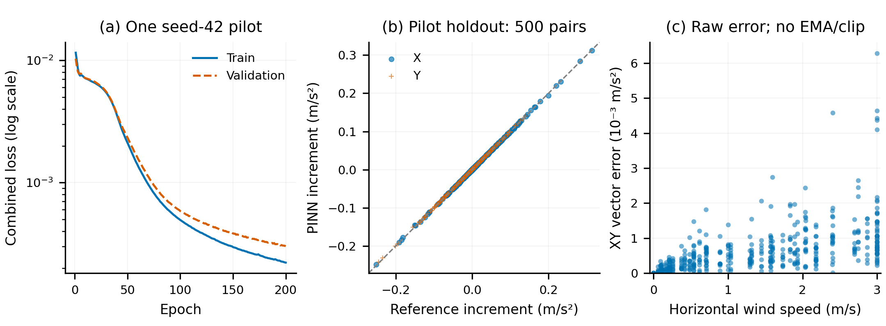

# Wind Field Simulation

本项目是一个用于测试和评估 **PX4 SITL 在风场中飞行表现** 的开源仿真项目。
项目采用 MuJoCo 模拟无人机动力学，通过 MAVLink 与 PX4 SITL 进行闭环交互，
支持开展无风基线与风扰条件下的飞行测试，观察无人机稳定性和轨迹跟踪表现。

项目提供可配置风场、交互控制面板和预定义轨迹，包含 X4-950 四旋翼、Airbot Play
机械臂及场景资源，默认使用 X4-950 PINN 气动代理生成外部风扰，
并保留解析气动参考与旧 PINN 的显式回退，为风扰测试和仿真开发提供基础。

## 项目结构

```text
Wind_field_simulation/
├── src/
│   ├── wind_field_simulation/
│   │   ├── simulation.py          # 仿真主程序，后续可逐步拆分
│   │   ├── wind_backends.py       # 新PINN与解析参考的运行适配
│   │   ├── training/             # 参考气动、配对采样、训练和评估
│   │   ├── _vendor/               # 权重兼容的 PINN、Normalizer、RotorPy 参数
│   │   └── assets/
│   │       ├── scenes/default/    # 主场景 XML
│   │       ├── robot_models/      # 四旋翼、机械臂、网格、柜子和纹理
│   │       ├── checkpoints/       # 新X4模型/参考版本目录，以及保留的旧权重
│   │       └── configs/           # X4-950.params
│   └── pymavlink/                 # 从当前 PX4 复制的协议库
├── third_party/PX4-Autopilot/     # 本地完整源码，首版GitHub仓库不包含
├── runtime/px4/                  # 随首版提供的已编译SITL程序和启动资源
├── scripts/                      # 仿真启动、SITL 启动和编译入口
├── tests/                        # 迁移后的离线回归测试
├── docs/                         # PX4 说明、迁移验证和来源记录
├── licenses/                     # 第三方许可证
├── outputs/                      # 新运行产生的参数、日志等，Git 默认忽略
├── pyproject.toml
└── requirements.txt
```

## Python 环境

参考环境为 Python 3.12，MuJoCo 3.6.0、NumPy 2.4.4、PyTorch 2.11.0、Matplotlib
3.10.9。Python 解释器、这些通用库、GPU 驱动和操作系统动态库通过环境安装；不复制
原 Conda 环境。项目专用代码、模型资源、权重和 PX4 源码均已复制。

```bash
python3.12 -m venv .venv
source .venv/bin/activate
python -m pip install -e '.[dev]'
```

本机已有 `env_uav` 环境，可直接使用，不必先安装本项目：

```bash
cd /home/raids/Wind_field_simulation
/home/raids/miniconda3/envs/env_uav/bin/python scripts/run_simulation.py --help
```

`pymavlink` 随本项目安装；建议使用独立虚拟环境，避免与其他版本相互覆盖。
只复制 RotorPy 所需的 Hummingbird 参数文件，因此不再需要安装完整 RotorPy。
这些参数仅用于保持旧 `pinn` 回退的输入契约，并不代表 X4-950 的机体参数；
默认新 `pinn-x4` 使用本项目 XML 派生的独立气动参考。

## 手动启动仿真

首版 GitHub 仓库包含仿真代码、模型、PINN 权重与冻结参考，以及已经验证的
`runtime/px4/bin/` 和 `etc/` **PX4 SITL 运行包**；不包含庞大的 PX4 源码、
构建缓存或 `outputs/` 实验日志。本地完整源码不删除、不修改。

运行包面向 **Linux x86-64**，与本项目当前 MuJoCo/浮点反馈适配及 X4-950 参数匹配，
无需先编译 PX4。它仍依赖宿主机动态库，包括 Gazebo Transport 13、Gazebo Messages 10、
Protobuf 与标准 C/C++ 库；依赖满足后可直接采用下面的双终端命令。
可用 `ldd runtime/px4/bin/px4` 检查缺失依赖，已测环境与来源见
[PX4 说明](docs/px4.md)。更换平台或重编译时需另行取得匹配的完整源码；
本地构建脚本和源码/补丁记录保留，但源码不随首版仓库上传。

以下为本机的完整启动命令，两个终端均显式激活 `env_uav`。若仍有旧仿真实例运行，
先在对应终端使用 `Ctrl+C` 结束它，再重新启动。

### 终端一：启动 PX4 SITL

```bash
source /home/raids/miniconda3/etc/profile.d/conda.sh
conda activate env_uav
cd /home/raids/Wind_field_simulation
bash scripts/run_px4_sitl.sh
```

保持终端一运行，再打开终端二。PX4 会等待仿真连接，无需等终端一返回命令提示符。

### 终端二：启动 MuJoCo 和控制面板

```bash
source /home/raids/miniconda3/etc/profile.d/conda.sh
conda activate env_uav
cd /home/raids/Wind_field_simulation
python scripts/run_simulation.py
```

该命令默认加载新 **`pinn-x4`** 后端，以及项目内独立版本目录中的权重与冻结参考。
显式回退仅需把终端二命令换成 `python scripts/run_simulation.py --wind-backend analytic`
或 `python scripts/run_simulation.py --wind-backend pinn`（旧模型）。终端一不变。

启动时没有已配置的风扰参数：X、Y 两个输入框为空，`Wind ON/OFF` 开关禁用。
必须先填写完整参数并点击 `Apply Wind`，仿真接受后才能开启风扰。
运行中可继续修改风速和方向，无需重启程序。已安装本项目时，也可运行
`python -m wind_field_simulation`。
兼容保留的命令行 `--wind-x/y` 只预填待应用草稿，不会配置或开启风扰，仍须点击
`Apply Wind`。显式预填时，未指定的水平分量按 0 填入；不传这些参数则两个输入框均为空。
仅支持水平风，Z 方向风速固定为 0，已移除 `--wind-z` 参数。

默认 TCP 端口为 4560，Offboard UDP 端口为 14580。启动脚本设置
`PX4_SIM_MODEL=none_iris`、`PX4_SIM_FLOAT_STATE=1`，并将新状态写入 `outputs/px4/`。
已有其他 SITL 实例占用端口时，应先自行结束对应实例。

当前 PX4 源码只保留 MuJoCo 真值反馈、浮点局部位置配对、电机输出适配和
X4-950 配置所需的本地修改，移除了未使用的历史控制入口及自定义 Gazebo 资源。
项目内默认运行包已从精简后的源码重新编译。
PX4 原生控制器使用 MuJoCo 状态真值，默认关闭 EKF2；该模式用于控制闭环测试。
源码基线和保留补丁见 [PX4 说明](docs/px4.md)。

### 控制面板点击顺序

首次测试建议按以下顺序操作：

1. **等待连接**：面板显示 `PX4: connected` 后，再进行飞行操作。
2. **Unlock（解锁）**：点击后等待 `Unlock: armed`，再执行起飞。
   若仍显示 `waiting for confirmation`，继续等待确认；被拒绝时查看面板和终端诊断信息。
3. **Takeoff（起飞）**：等待无人机起飞并稳定悬停，先观察无风状态下的表现。
4. **选择轨迹（可选）**：点击 `Figure-8`、`Ellipse`、`Circle` 或 `Square` 中的一个，
   开始相应轨迹跟踪。也可使用 `X+ / X- / Y+ / Y- / Z+ / Z-` 按钮，
   每次将世界系位置目标沿对应方向移动 `0.5 m`。
5. **设置并开启风扰（可选）**：在右下方的 `Horizontal wind (world, m/s)` 中输入
   `X / Y` 两个水平风速分量，点击 `Apply Wind`，等待参数被接受、开关解除禁用，
   再点击 `Wind OFF` 将风扰开启。
   开启后仍可修改分量并点击 `Apply Wind`，在后续仿真步中生效；点击 `Wind ON` 可关闭风扰。
6. **Land（降落）**：测试结束后，可先关闭风扰，再点击 `Land`，等待无人机落地。
7. **Exit（退出）**：落地后点击 `Exit`，关闭仿真并结束终端一的受管理 PX4 SITL。
   正常退出后，两个终端都返回命令提示符，终端窗口保留。

常用顺序：**等待连接 → Unlock → 确认 armed → Takeoff → 悬停／轨迹／风扰测试 → Land → Exit**。

`Emergency` 会立即停止转子，仅在需要紧急停机时使用。

### 运行中调整风速与方向

风速输入使用世界坐标系，单位为 `m/s`，Z 方向风速固定为 0。
X、Y 分量的正负号表示水平气流吹向，例如：

| X | Y | 含义 |
| --- | --- | --- |
| 1 | 0 | 沿 +X 方向，合风速 1 m/s |
| 0 | -2 | 沿 -Y 方向，合风速 2 m/s |
| 1 | 1 | 沿 XY 平面对角方向，合风速约 1.41 m/s |

首次启动显示 `Wind not configured.`。编辑输入框后，必须点击 **Apply Wind** 才提交
整组参数；提交成功前 `Wind ON/OFF` 始终禁用。下方 `Set` 显示仿真已接受的 X、Y 风速，
`Speed` 显示合风速；应用设置不会自动开启风扰。全零向量也属于有效配置。
关闭风扰会保留已接受的参数，之后可再次开启，无需重复 Apply。
两个后端均要求水平合风速 **≤3 m/s**；`[3,3,0]` 超域。
空值、非数字、NaN、无穷值或超出风域的输入会显示红色提示并保留
上一组有效设置。状态刷新会保留尚未提交的输入。新风速经过所选后端、原 EMA
滤波及限幅流程转换为风扰外力。

当前仍为空间均匀风场，参数在两次手动修改之间保持恒定。
本项目的水平扰动模式同时约束风速和实际施加的风扰外力：`wind_z=0`、`force_z=0`。
所选后端保留原始三轴预测，施力前只取其 XY 分量并清零 Z 滤波状态；原始预测的 Z
分量可能非零，可用于诊断，但不会作为垂直风扰施加。无人机升力、重力和高度控制
继续按原模型运行。

### 显示与退出说明

蓝色风向标记使用“短杆＋实心三角箭头”，方向及箭头平面固定为世界 XY，
沿已配置水平风向移动，不随无人机姿态倾斜。斜视相机下可能有正常的屏幕透视斜率，
不表示存在 Z 风速或垂直风扰力。

`--no-viewer`
仅关闭 MuJoCo 三维窗口，仍保留 Matplotlib 面板，因此不等同于无图形界面模式。
`--xml-path`、`--params-path` 仍支持自定义文件。

点击 **EXIT** 后，仿真窗口会关闭，同时通知终端一的启动器结束它创建的 PX4 SITL
子进程；两个终端随后回到命令提示符，终端窗口本身保留。启动器使用项目状态目录
内的会话标识和文件锁进行退出联动，不会按进程名称批量结束其他 PX4 实例。
更新到这一版本后，需要先结束旧的 SITL，再用 `bash scripts/run_px4_sitl.sh`
重新启动终端一，才能启用退出联动。若自定义 `PX4_STATE_DIR`，两个终端须设置相同值。

更换机器或需要修改飞控时，参见 [PX4 源码与编译说明](docs/px4.md)。

## 离线验证

```bash
PYTEST_DISABLE_PLUGIN_AUTOLOAD=1 MPLBACKEND=Agg python -m pytest -q
```

关闭 pytest 自动加载是为了避免本机 ROS 等无关插件干扰测试。测试使用内存中的
MAVLink 消息和无窗口图形后端，不启动 SITL、不建立真实飞控连接。
运行包版不包含 PX4 源码时，依赖其头文件的单项 C++ 配对契约测试会明确跳过；
完整源码开发目录仍执行该测试，其余离线测试不受影响。
验证结果见 [迁移报告](docs/migration.md)。

## 独立 X4-950 气动参考

已建立默认初始机械臂姿态的分部件二次阻力参考，风域为**水平合风速 0–3 m/s**。
它已作为显式 `analytic` 回退后端接入，默认使用新 `pinn-x4`。空气密度、Cd 和等效几何
均带明确假设；不能据合成结果宣称真实飞机气动精度。

```bash
/home/raids/miniconda3/envs/env_uav/bin/python scripts/export_x4_950_parameters.py
/home/raids/miniconda3/envs/env_uav/bin/python scripts/check_x4_950_reference.py
```

Task 1–2 的接口、29 个几何代理选择、行为/计算成本检查及复现命令见
[参考模型检查记录](docs/x4-950-reference-v1.md)。解析方案继续保留。

解析启动示例（仍须在面板 Apply 后手动开风）：

```bash
python scripts/run_simulation.py --wind-backend analytic \
    --reference-config outputs/pinn/x4_950_wind_v1/reference_config.json
```

旧模型显式回退为 `python scripts/run_simulation.py --wind-backend pinn`。
可选 `--run-log PATH` 保存 50 Hz 对照日志，已有文件不会覆盖。
完整双终端命令、无风/解析/旧 PINN 对照流程和汇总方法见
[SITL 对照步骤](docs/analytic-wind-sitl-comparison.md)。
已完成悬停 OFF/1 m/s +X 的首轮真实无窗口 SITL 对照（两后端各3次，12/12完整运行），
结果、原始产物来源和未验证范围见 [首轮对照报告](docs/SITL_FIRST_ROUND_2026-11-10.md)。

用户随后授权的 **3,000 对样本 PINN pilot 已完成**：6 维机体系新网络试训练，
500 对留出样本非零风归一化误差 1.28%，零风增量精确为 0。
候选独立保存在 `outputs/pinn/x4_950_pilot_v1/training_corrected/candidate.pt`，
pilot 阶段未替换旧权重；随后完成接入和对照，现已按用户要求设为默认，解析与旧PINN可显式回退，不修改PX4。
数据、误差、零风/软物理约束残差、CPU 耗时与复现命令见
[pilot 报告](docs/X4_PINN_PILOT_2026-11-10.md)。合成参考拟合不代表实物气动精度。

新 `pinn-x4` 已设为默认。其权重与参考打包在
`src/wind_field_simulation/assets/checkpoints/x4_950_wind_v1/`，原旧模型文件未覆盖。
默认启动无需传模型路径；也可显式覆盖路径来复现原实验版本：

```bash
python scripts/run_simulation.py --wind-backend pinn-x4 \
  --reference-config outputs/pinn/x4_950_wind_v1/reference_config.json \
  --pinn-checkpoint outputs/pinn/x4_950_pilot_v1/training_corrected/candidate.pt
```

仍须在面板 Apply 后手动开风；共用原 XY/EMA/限幅链路。
错误模型或参考版本在连接 PX4 前拒绝，不静默更换后端。
旧模型回退：`python scripts/run_simulation.py --wind-backend pinn`；解析选择命令不变。
解析回退可简写为 `python scripts/run_simulation.py --wind-backend analytic`，
默认使用与新PINN相同的冻结参考。缺失/不匹配时直接报错，不静默更换模型。
接口、范围和物理限制见 [模型卡](docs/models/x4-950-pinn-pilot-v1.md)。

新PINN/解析的真实无窗口SITL对照已完成：悬停OFF/+X1/2/3m/s、每组3次重启，
**24/24完整落地退出**，全部实际Fz=0、主窗限幅/超域占比0。
配对位置RMSE差值通过预设门槛；完整施力路径未显示提速优势。
离线220项验证、对照数据/图、双终端启动和回退命令见
[接入与SITL报告](docs/X4_PINN_INTEGRATION_2026-11-10.md)。其它风向/轨迹与GUI仍需单独验证。

## PINN 的作用与训练方法

### 在仿真中的作用

默认后端 `pinn-x4` 是带物理先验和软约束的神经气动代理。它根据无人机当前状态
和设定风速，计算风引起的**额外水平气动加速度**，再由仿真施加外力。
PX4 原生控制器继续负责飞行控制，通过闭环反馈抵抗该扰动。

网络核心 `gθ` 使用 6 维机体系输入：相对空气速度 `v_air^B` 的三个分量和
机体系角速度 `ω^B` 的三个分量，输出完整三轴参考气动加速度，单位为 m/s²。
每个仿真步在同一状态下批量计算有风、无风两行输入，再取差值：

```text
a_wind^W = P_xy · R_WB · [gθ(R_WBᵀ(v_O^W − w^W), ω^B)
                         − gθ(R_WBᵀ v_O^W, ω^B)]
```

这里 `v_O^W` 是根点 O 的世界系速度，`w^W` 是世界系风速，`R_WB` 将机体系
旋转到世界系，`P_xy=diag(1,1,0)` 只保留世界水平分量。两个输入共享位置、姿态、
角速度和冻结几何，仅风速不同。因此当前无风基线保持原样，风为零时原始增量精确为零。

施力继续经过 **XY 投影 → EMA（alpha=0.05）→ 逐轴 ±6 m/s² 限幅 →
乘整机质量 8.0004 kg → 根 body 外力**。原始三轴增量用于诊断，实际风力 Fz=0，
不额外施加气动力矩。把已开启的风 Apply 为零时，已有 XY 滤波状态按原逻辑衰减；
关闭风扰则重置滤波和风力。

当前适用范围为默认 X4-950 + Airbot Play、固定初始气动几何、无新增载荷，
**水平合风速 0–3 m/s、风 Z=0**。例如 `[3,3,0]` 超域。解析后端可直接评价同一参考，
用于对照；旧 `pinn` 保留历史模型回退。当前闭环施力路径没有显示新 PINN 的提速优势。

### 数据来源与标签

训练数据来自独立简化气动参考的离线状态扫描。参考从本项目 XML 派生 29 个去重
部件几何代理，按部件局部相对速度计算逐轴二次阻力，并累加完整气动力；角速度
通过部件点速度进入计算。空气密度 `1.225 kg/m³`、逐轴 `Cd=1.0` 是明确的仿真假设。
公式、代理选择和未建模效应见 [气动参考说明](docs/x4-950-reference-v1.md)。

对每个状态计算有风与无风参考力，保存完整三轴力及配对的水平增量标签：

```text
y_wind^W = P_xy · [F_ref^W(s,w) − F_ref^W(s,0)] / m_total
```

标签在滤波和限幅之前生成；旧 PINN 输出及不同闭环轨迹间的加速度差不作为真值。
标称数据只采用一组冻结气动参数，避免将不同隐藏参数的冲突标签混入同一网络。

目前已完成 **3,000 对样本 pilot**，采样 seed=7，以每组 10 个状态为单位划分为
2,000 对训练、500 对验证、500 对 pilot 留出；配对不拆分，检查跨集合的机体系
核心输入重复，归一化只从训练集计算。采样包含零风、3 m/s 边界、不同风向、
零角速率、悬停邻域及与风相反的运动。完整状态范围见 [模型卡](docs/models/x4-950-pinn-pilot-v1.md)。
这 500 对留出仅作 pilot 诊断，正式 120,000 对数据、多 seed 训练及正式测试尚未开展。

### 网络、损失与训练设置

网络为**固定非负逐轴二次阻力先验 + `6→64→64→3` Tanh 残差 MLP**。
先验系数由标称参考的正负单位轴样本拟合并随权重存档；新网络从头训练，
不使用旧模型的 17 维特征、Hummingbird 悬停转速或旧归一化统计。

损失由三部分构成：完整机体系气动加速度误差、世界 XY 风增量误差，以及权重为
0.01 的正功软惩罚。两项监督误差使用训练集的逐轴尺度归一化，输出尺度下限为
0.05 m/s²。正功项只作用于 `ω=0` 子集的完整输出 `a_full^B·v_air^B`；
风增量本身允许输入能量，不对其强加耗散条件。这里的物理信息来自简化阻力先验
和软约束，训练目标是拟合所选解析参考。

| 项目 | 当前 pilot 设置 |
| --- | --- |
| 框架与设备 | PyTorch、CPU float32、单 Torch 线程、确定性算法 |
| 训练 seed | 42 |
| 优化器 | AdamW，学习率 1e-3，weight decay 1e-5 |
| Batch size | 1,024 对样本 |
| 轮次与选模 | 最多 200 epoch，按验证损失选权重，early stopping patience=20 |
| 学习率调度 | ReduceLROnPlateau，factor=0.5、patience=5 |
| 梯度裁剪 | 梯度范数上限 1.0 |

本次实际完成 200 epoch，最佳验证轮次为第 200 轮。500 对留出样本的 XY RMSE
为 `0.000655 / 0.000617 m/s²`，非零风归一化向量误差为 `1.28%`。
训练/验证损失曲线及留出误差如下；这是单次训练结果，没有跨训练置信区间。



合成参考拟合与 24 次 SITL 对照分别评价代理误差和闭环表现，不能证明真实飞机
气动精度。完整网络输出仍有微小静止偏置，正功软惩罚也不保证全域耗散；
零风精确为零指配对差分输出。详细残差、指标与边界见
[pilot 报告](docs/X4_PINN_PILOT_2026-11-10.md)。

### 复现 pilot

正常使用仿真无需重新训练。以下流程在 `env_uav` 中离线生成数据、试训练和评估，
不启动 PX4。当前入口限定 3,000 对 pilot；输出目录必须使用新名字，已有目录会拒绝覆盖。

```bash
source /home/raids/miniconda3/etc/profile.d/conda.sh
conda activate env_uav
cd /home/raids/Wind_field_simulation

# 导出并检查配置文件所引用的独立参考
python scripts/export_x4_950_parameters.py
python scripts/check_x4_950_reference.py

PINN_RUN_DIR=outputs/pinn/x4_950_pilot_readme_01
python scripts/generate_x4_wind_dataset.py \
  --config configs/pinn/x4_950_pilot_v1.json \
  --output-dir "$PINN_RUN_DIR/dataset"
python scripts/train_x4_wind_pinn.py \
  --manifest "$PINN_RUN_DIR/dataset/manifest.json" \
  --output-dir "$PINN_RUN_DIR/training"
python scripts/evaluate_x4_wind_pinn.py \
  --manifest "$PINN_RUN_DIR/dataset/manifest.json" \
  --checkpoint "$PINN_RUN_DIR/training/candidate.pt" \
  --output-dir "$PINN_RUN_DIR/evaluation"
```

产物包括配对数据 `pairs.npz`、来源/散列 `manifest.json`、权重 `candidate.pt`、
训练过程 `history.json`、训练配置与指标 `training_summary.json`、评估结果
`evaluation.json` 和预测数组。checkpoint 同时保存归一化、先验、质量、臂姿态、
坐标/单位、参考及数据指纹，加载时校验兼容性。

新试训权重不会自动覆盖当前默认模型。需要试用时，先完成离线评估，再通过
`--pinn-checkpoint` 选择新权重、`--reference-config` 选择其匹配参考，并按
[SITL 对照步骤](docs/X4_PINN_INTEGRATION_2026-11-10.md) 单独进行闭环验证。

## 来源与开源准备

原项目保持原样。新项目运行代码通过包内路径读取资源，不依赖旧 PX4 或 PINN
目录。首版仓库只提供已编译PX4运行包；飞控源码的官方基线、精简后补丁与校验清单，以及原始迁移记录，均位于
[docs/provenance](docs/provenance)；历史归档记录不代表当前精简后源码。

本目录尚未发布，也未替所有材料指定统一开源许可证。已有 XML 标有 RAIDS Lab
版权声明，PINN 代码和权重的上游目录未找到顶层许可证；发布前需要权利人确定
授权。第三方材料沿用其已有许可证，详见 [THIRD_PARTY_NOTICES.md](THIRD_PARTY_NOTICES.md)。
