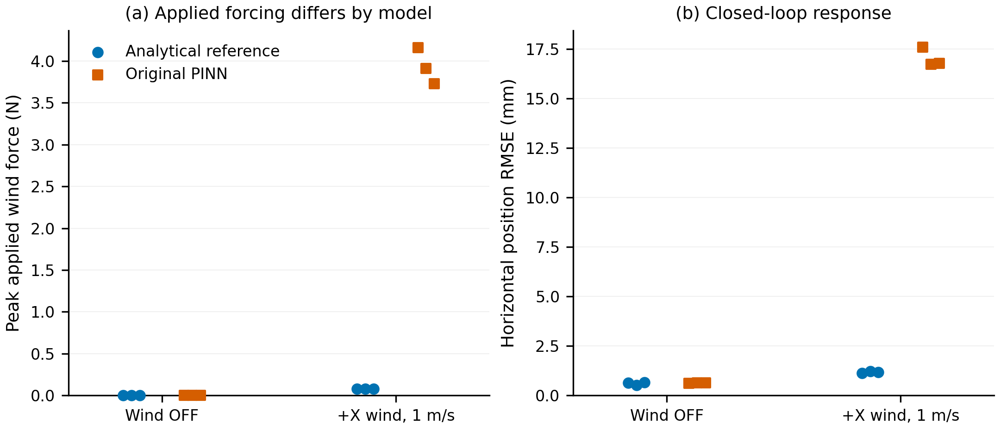

# 首轮真实 PX4 SITL 闭环对照结果

日期：2026-11-10。**12/12 个正式工况完成，解析后端已通过本轮真实 SITL 悬停对照。**
本轮为无窗口自动化运行，使用真实 PX4 二进制、真实本地 MAVLink 和生产 MuJoCo 仿真循环，
不是进程替身或离线预测测试。没有训练新 PINN，默认仍为原 PINN。

## 本轮覆盖范围

| 项目 | 实际执行 |
| --- | --- |
| 后端 | 独立解析参考、原 PINN，各自显式选择 |
| 工况 | 无风 OFF 基线、1 m/s 世界 +X 风 ON，均为悬停 |
| 重复 | 每个后端/工况 3 次独立重启，正式编号 r4/r5/r6 |
| 每轮 | 等待新鲜心跳、确认解锁、Offboard 起飞、70 秒观察、降落、Exit、受管理退出 |
| 主分析 | 每轮裁剪前 5 秒后，分析 60 个仿真秒；50 Hz，合计 36,006 条样本 |
| 整段日志 | 62,607 条观察样本，包含启动/起降阶段；全部风力 Z 精确为零 |
| 机型 | 原 X4-950 + Airbot Play、初始参考臂/夹爪姿态、无新增载荷 |
| 控制链路 | 当前 PX4 真值反馈配置、原 XY 投影、EMA(alpha=0.05)、逐轴 ±6 m/s² 限幅和单点 force-only |

为避免默认实例端口冲突，使用 PX4 官方多实例机制：instance=6、TCP=4566、
Offboard UDP=14586、MAVLink 目标系统=7。两后端配置一致。
每轮从同一份 `parameters.bson`/backup 副本启动独立状态目录，没有覆盖当前 `outputs/px4/`。
官方启动脚本按实例设置消息标识；未自定义修改飞控控制参数、PX4 源码或二进制。
原气压噪声 seed=0，没有新增随机轨迹。三次为同种子独立重启，描述运行重复性，不是独立实物试验。

## 主窗口结果

以下为 **三次运行均值 ± 样本标准差（n=3）**。水平误差指
`sqrt(mean((x-x_target)^2 + (y-y_target)^2))`，目标与位置来自同一记录时刻。
50 Hz 半开时间窗受浮点边界影响，每轮为 3,000 或 3,001 条样本。

| 风工况 | 后端 | 水平位置 RMSE (mm) | 高度 RMSE (mm) | 各轮峰值风力范数的均值 (N) |
| --- | --- | --- | --- | --- |
| OFF 无风 | 解析 | 0.607 ± 0.072 | 2.749 ± 0.006 | 0 |
| OFF 无风 | 原 PINN | 0.620 ± 0.012 | 2.755 ± 0.022 | 0 |
| 1 m/s +X | 解析 | 1.172 ± 0.040 | 0.066 ± 0.002 | 0.08158 |
| 1 m/s +X | 原 PINN | 17.042 ± 0.485 | 0.270 ± 0.215 | 3.93233 |

正式窗口均满足：实际风力 `Fz=0`、风加速度限幅占比=0、已有速度/倾角/角速度检查域超域占比=0。
所有正式日志正常关闭、无记录的控制错误，12 个受管理启动器返回 0。
实验结束后确认 TCP4566 无监听、无 PX4 进程遗留。

**这不是气动精度排名。** 两种模型施加的扰动幅值明显不同，解析参考的跟踪误差较小，
不能据此推断其更接近真实 X4-950；也不能把原 PINN 当成独立真值。
本轮没有实测风洞/飞行气动力数据，没有得到辨识后的 Cd。



每个点对应一次完整重启后的主窗口结果，n=3；点的水平偏移只用于区分重复。
未做显著性检验，没有置信区间或仅均值柱状图。
[PDF](figures/sitl-wind-first-round-2026-11-10.pdf) /
[SVG](figures/sitl-wind-first-round-2026-11-10.svg)。

## 起飞过渡、关节偏离与计算成本

无风主窗从首次 FLYING+5 s 开始；有风先在 FLYING 后悬停 10 s 再开风，
主窗从开风+5 s 开始。无风主高度误差包含更多起飞收敛残留，不能把表中高度差直接归因于风。

为解释这一时序差异，另作 **50 秒对齐稳定阶段补充分析**：无风取 FLYING+15 至+65 s，
有风取开风+5 至+55 s。此分析是在第一轮基线暴露残余过渡后补充，**没有替换预定的 60 秒主结果**。
补充高度 RMSE 的三次均值为：无风解析 0.063 mm、无风原 PINN 0.068 mm、
有风解析 0.066 mm、有风原 PINN 0.295 mm。原始风力 Z 为零不等于高度误差必须为零；
重力、升力和姿态耦合继续由原多体模型与控制器处理。

正式窗口中，六个臂关节的最大初始姿态偏离约 **0.002641 rad（0.151°）**，
夹爪滑动关节的最大偏离约 **0.0533 mm**。这支持记录并检查冻结几何近似，
不构成机械臂完全不动或几何近似精确的证明；参考未跟随实际关节重算。

有风时，三轮各自风扰计算 P95 的均值：解析 **1.166 ms**、原 PINN **1.159 ms**。
三轮各自迭代计算 P95 的均值：解析 **2.945 ms**、原 PINN **2.714 ms**。
这些是当前应用默认设备选择下的观测，不是相同硬件算子的公平推理 benchmark；
不能从这个差值推断网络或解析模型普遍更快。
迭代计时不含随后日志写入、图形刷新、主动 pacing sleep，且采样 50 Hz，
不证明全循环最坏时延或有 GUI 时的硬实时性。

## 三次失败探测与必要修复

以下记录全部保留且不计入正式三次重复：

1. `analytic_hover_w0_x_r1`：首次独立 PX4 状态初始化超过 10 秒，心跳等待过短，起飞前停止。
   实验驱动改为至少等待 10 秒且收到新鲜心跳后才继续，最长 60 秒。
2. `analytic_hover_w0_x_r2`：悬停完成，但降落接触地面时，HIL 状态包的有符号 int16 字段打包越界。
   不将这轮称为正常完成，也不挽救其观察段混入正式统计。
3. `pinn_hover_w0_x_r3`：默认实例/端口冲突，起飞前失败；未终止占用者，正式批次改用隔离实例 6。

降落问题修复仅在 Python 桥接：六个 HIL_STATE_QUATERNION 整数速度/加速度字段，
在转换前饱和到 `[-32768,32767]`；正常值保留原截断行为。
浮点 LOCAL_POSITION_NED 位置/速度和浮点 HIL_SENSOR 保持完整值，风模型及其限幅不变。
新增正/负两例真实 MAVLink 编解码回归先复现失败、再通过；**离线全量 197 passed in 25.30s**。
随后 12 轮真实 SITL 均完整落地退出；独立只读审阅未发现阻塞问题。

保留既有接收端 `acceleration_integer/1000` 的兼容约定，没有在本轮重构单位或修改 PX4。
因此该整数路径的接收加速度仍受约 ±32.768 m/s² 范围限制。
MAVLink 标准字段标注为 mG，当前接收实现的历史约定不能冒充通用 HIL 单位合规验证；
浮点传感器路径完整也不消除此整数路径限制。

## 来源、复现与下一阶段

指标与来源归档：

- [逐次指标 CSV](provenance/sitl-first-round-2026-11-10/per_run_metrics.csv)、
  [汇总 JSON](provenance/sitl-first-round-2026-11-10/summary.json)。
- [正式协议](provenance/sitl-first-round-2026-11-10/protocol_v2.json)、
  [完整性检查](provenance/sitl-first-round-2026-11-10/integrity_check.json)、
  [原始产物散列清单](provenance/sitl-first-round-2026-11-10/manifest.json)。
- [实验原始目录](../outputs/closed_loop/sitl_compare_2026-11-10)：每轮 `flight.jsonl`、
  `result.json`、PX4 console/ULog、参数副本、驱动脚本和未纳入统计的探测记录。
  `outputs/` 沿用 Git 忽略策略，归档清单记录原始产物的相对路径和 SHA256。

原始 XML 审计 12 份文件、PX4 适配/配置 7 份文件、运行二进制和原始状态参数均通过散列不变检查。
全部正式记录使用同一 Python 仿真源码散列和同一参数种子。
复算主结果（不启动 SITL、不训练）：

```bash
cd /home/raids/Wind_field_simulation
/home/raids/miniconda3/envs/env_uav/bin/python outputs/closed_loop/sitl_compare_2026-11-10/summarize_matrix.py
```

单轮新复验可使用保存的 `run_case.py --backend analytic --speed 1 --repeat 7`，
使用尚不存在的编号，不覆盖原日志；驱动使用专属实例并自行管理会话。
GUI 手动流程仍见 [运行步骤](analytic-wind-sitl-comparison.md)。

当前结论是：**解析参考可作为本轮悬停工况的仿真候选，暂没有测得必须训练 PINN 的理由。**
它只验证了当前真值反馈 SITL、固定参考几何和所选气动假设下的行为。
尚未覆盖 2/3 m/s、其它风向、Circle/Figure-8、机械臂活动、GUI 鼠标/窗口退出或实物气动精度，
不宣称整个 0–3 m/s 包线已通过闭环。
后续按原计划扩展工况；Task 3–4 训练保持未执行，默认后端和旧权重保留。
