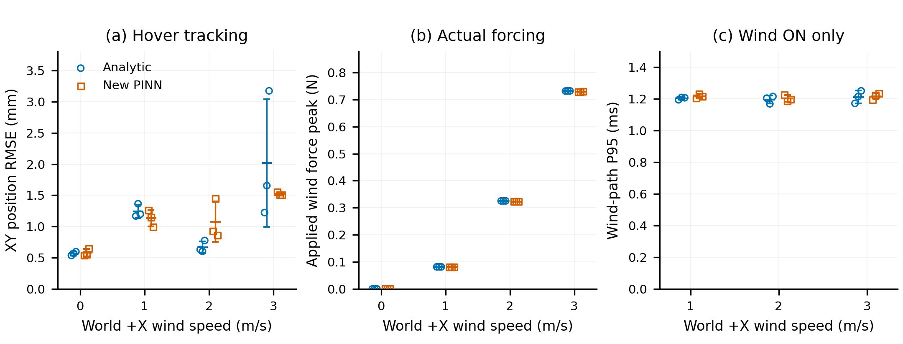

# X4 PINN 可选后端接入与闭环对照

更新：2026-11-10。24次对照完成后，用户已明确要求将新模型 **`pinn-x4` 设为默认**；
`pinn`（旧模型）和 `analytic` 保留显式回退。未训练新一轮权重、未修改PX4、未覆盖旧权重。
本轮使用已完成的3000对 pilot，而非正式120k模型。

## 接口与施力

`X4PinnWindResidualModel.predict(v_O_world, quaternion_wxyz, omega_body, wind_world)`
批量计算同状态有风/无风的6维机体系输入，返回原始三轴世界增量，单位m/s²。
原始Z仅用于诊断；施力继续由原函数完成：

`XY投影 → EMA(alpha=.05) → 逐轴±6m/s²限幅 → 整机质量 → 根body单点force-only`。

`_apply_wind_force`、`ResidualSafetyFilter`、`apply_external_wind_force`
与接入前快照的AST完全一致。没有改控制器、MuJoCo fluid、臂保持、坐标反馈、
启动参数或力矩入口。

新模型默认读取assets/checkpoints/x4_950_wind_v1中的checkpoint与冻结reference，
也可显式覆盖路径；加载时验证kind、6维features、
归一化与tensor一致性、坐标单位、质量、臂姿态、reference内容/散列、
XML/mesh闭包及实际编译模型。CPU float32、单Torch线程，不依赖旧RPM或normalizer。
版本错误在创建桥接连接前拒绝，不静默退回其它模型。日志记录真实后端、
checkpoint/data/reference散列、运行代码、线程和设备。

水平合风速0–3m/s且wz=0，不按每轴3m/s解释。固定初始气动几何；
其它状态范围与未建模效应见 [模型卡](models/x4-950-pinn-pilot-v1.md)。
Apply与无效值保留、XY滤波状态保留、全零配置和关风重置逻辑继续保持。
将风Apply为0时原始增量精确0，但已有XY EMA按原逻辑衰减；关风则直接重置。

## 离线证据（已完成）

- 全量 **220 passed in28.69s**，无跳过；真实候选SITL启动在离线验证完成之后。
- 独立代码审查未发现Critical/Important或需要改源码的Minor；审查者另跑9项新测试通过。
- 真实pilot权重经生产adapter/app扫描500个留出状态：XY RMSE
  .000655/.000617m/s²，非零风归一化误差1.282%，向量误差P95 .001717m/s²。
- 该扫描原始Z峰值 .0734m/s²，实际施力Fz精确0；逐样本手算XY EMA/质量换算
  与应用输出差异精确0。3000个状态零风原始增量精确0。
- 错误元数据、错误单位/质量/依赖/臂姿态、非单位四元数及非法风输入均拒绝；
  测试覆盖旧PINN默认与显式回退、新模型不加载旧权重、Apply门控、真实XY/限幅链路。

离线明细：`outputs/closed_loop/x4_pinn_compare_2026-11-10/offline_check.json`。
这部分没有启动PX4，也不作为飞行证据。

## 本轮SITL协议

真实本机PX4与MuJoCo生产循环，无窗口。解析/新PINN × 悬停OFF/+X1/2/3m/s ×
3次全新重启，共24次，固定seed7决定工况顺序，后端先后交替。
均使用相同XML、初始状态和独立复制的相同BSON参数种子。
专用官方instance6，TCP4566、UDP14586、targetsys7，实验独立状态目录；
不更改飞控控制参数，只请求和清理本轮拥有的启动会话。

解锁确认后起飞，FLYING后等待10s再开风，每条工况70s观测，
主窗口固定丢弃首个匹配状态后5s、分析随后60s。OFF从FLYING开始计时，
有风从开风开始；各后端在相同工况下同样处理。时间裁剪不自动证明已稳定。
OFF窗口可能保留起飞收敛阶段，不将其高度RMSE与晚10s的有风窗口直接解释为风的收益。

完整性判定除了飞行/log的complete，还单独检查owned launcher returncode、
managed shutdown返回、结束记录、样本窗及源/参数/checkpoint指纹。
位置替代门槛按既定计划：每配对重复
`RMSE_new - RMSE_analytic <= max(.1*RMSE_analytic,.02m)`，并报告原始差值。
记录所有窗口内外实际Fz、风力/clip、超域、臂偏离、姿态、旋翼输出及耗时。
同状态网络/解析误差从每条实际轨迹的状态重新评价，不用两条轨迹加速度相减当真值。

原始产物：`outputs/closed_loop/x4_pinn_compare_2026-11-10/`。
协议/计划顺序先于运行保存；异常与探测结果保留，不覆盖。
本轮仅悬停与+X，不覆盖其它方向、Circle/Figure-8或GUI鼠标/窗口EXIT路径。
合成参考的一致性不是实物气动标定。

## 本轮真实SITL结果（已完成）

**24/24正常完成**：完整主窗口、落地退出、owned launcher返回0均通过；
managed shutdown返回成功24/24。无剔除或失败案例。
每组n=3，以下为均值±样本标准差，不是置信区间。相同种子不等于异步PX4/桥接的逐步数值重放。

| +X风速 | 解析XY RMSE (mm) | 新PINN XY RMSE (mm) | 新−解析，配对差值 (mm) |
| --- | ---: | ---: | ---: |
| OFF | 0.566±0.031 | 0.577±0.060 | +0.011±0.035 |
| 1m/s | 1.243±0.106 | 1.132±0.132 | -0.111±0.174 |
| 2m/s | 0.669±0.093 | 1.077±0.323 | +0.409±0.395 |
| 3m/s | 2.018±1.026 | 1.523±0.025 | -0.495±1.042 |

全部12组配对的既定替代门槛通过：最大正RMSE差值为0.847mm；
本轮门槛由20mm绝对项主导。**这不表示相对误差均小于10%**，应以上表原始差值判断。
源、参数、checkpoint和模型版本一致，原始误差未被限幅掩盖。

| +X风速 | 解析力峰值 (N) | 新PINN力峰值 (N) | 解析高度RMSE (mm) | 新PINN高度RMSE (mm) |
| --- | ---: | ---: | ---: | ---: |
| OFF | 0.000±0.000 | 0.000±0.000 | 2.728±0.016 | 2.759±0.008 |
| 1m/s | 0.081±0.000 | 0.081±0.000 | 0.064±0.017 | 0.059±0.006 |
| 2m/s | 0.325±0.000 | 0.323±0.000 | 0.055±0.006 | 0.071±0.006 |
| 3m/s | 0.732±0.000 | 0.729±0.001 | 0.059±0.020 | 0.064±0.012 |

全部50Hz记录的实际Fz精确0；主窗风扰限幅占比0、检查域外样本占比0。
最大臂关节偏离0.002613rad（0.150°），
夹爪偏离0.0034mm；固定气动几何近似未扩展到活动臂。
主窗最大|roll|/|pitch|约0.092/0.587°；
桥接归一化旋翼输出范围0.4920–0.5080，触轨样本占比0。
这里的旋翼输出指标不代表已记录PX4全部内部控制约束标志。

| 有风工况 | 解析风施力路径P95 (ms) | 新PINN风施力路径P95 (ms) | 新PINN同飞行状态水平增量归一化误差 |
| --- | ---: | ---: | ---: |
| 1m/s | 1.203±0.008 | 1.217±0.013 | 1.183% |
| 2m/s | 1.195±0.024 | 1.202±0.021 | 0.882% |
| 3m/s | 1.212±0.040 | 1.216±0.020 | 0.553% |

耗时为50Hz采样的整个施力路径，包括校验、坐标转换/推理及共用施力，
不等于纯网络内核、不含UI/日志写入/pacing sleep，也不构成硬实时保证。
解析为NumPy float64且含诊断力矩，新网络CPU float32，工作量/精度不同。
本轮完整施力路径P95均约1.2ms，**没有观察到新PINN在该路径上的提速优势**；
不能将此前离线配对调用的耗时差直接推广到闭环。



空心点为每次实际重启结果，横向微移仅避免重叠；短横线±误差棒为均值±SD，n=3。
OFF不调用风预测器，因而耗时面板只显示有风工况。

紧凑数据与协议见 [provenance目录](provenance/x4-pinn-sitl-2026-11-10/)。
本轮支持将候选用于已测悬停/+X工况；随后按用户要求设为默认，保留旧模型与解析回退。
上述24次对照是在默认切换前显式选择pinn-x4/原产物路径执行，不是默认切换后的新飞行证据。
其它方向、Circle/Figure-8、GUI路径、状态外推及实物气动精度仍未由本轮验证。


## 用户双终端运行

终端一启动PX4（若有其它实例，使用其自己的终端退出，不按进程名批量终止）：

```bash
source /home/raids/miniconda3/etc/profile.d/conda.sh
conda activate env_uav
cd /home/raids/Wind_field_simulation
bash scripts/run_px4_sitl.sh
```

终端二新PINN：

```bash
source /home/raids/miniconda3/etc/profile.d/conda.sh
conda activate env_uav
cd /home/raids/Wind_field_simulation
python scripts/run_simulation.py
```

如需日志可加 `--run-log outputs/closed_loop/pinn_x4_manual_01.jsonl`，文件需选新名字。
控制台/面板确认pinn-x4，等待连接、Unlock确认、Takeoff，
稳定悬停后输入水平风速，Apply后再Wind ON。Land落地后Exit。
输入框、位置微调、预定义轨迹使用原界面。

退出两程序后，终端一同样重启，终端二可显式选解析：

```bash
python scripts/run_simulation.py --wind-backend analytic
```

或旧PINN回退：

```bash
python scripts/run_simulation.py --wind-backend pinn
```

旧PINN不传reference或新checkpoint。默认不带选择参数使用新pinn-x4。
