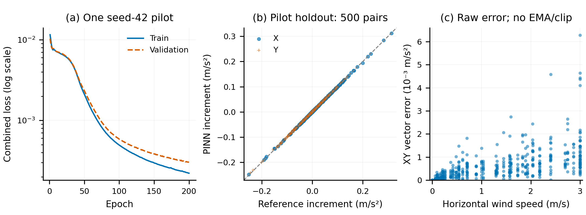

# X4-950 小规模 PINN pilot

本文件记录pilot阶段。后续已接为可选 `pinn-x4` 并完成首轮24次SITL，
见 [接入与对照报告](X4_PINN_INTEGRATION_2026-11-10.md)；下文“尚未接入”是当时状态。

2026-11-10，应用户明确要求执行 3,000 对样本生成及试训练。
**已得到独立的新 PINN pilot checkpoint，尚未接入仿真或切换默认后端。**
解析后端、旧权重、当前 XY/EMA/限幅链路保留，未修改 PX4。
本报告的最终候选来自 `training_corrected`，首轮产物留档但已被取代。

## 数据与验证边界

- 来源：冻结的分部件解析参考离线状态扫描，不是实测或飞行数据。
  参考 SHA256 为
  `613e8c2840f524ec5caf742a7d03a00dff930fc006669612953d1abc897f5e1a`。
- 3,000 对同状态有风/无风样本；采样 seed=7，三个独立 SeedSequence
  子流。每组 10 个独立状态，按整组分为 train 2,000 / val 500 /
  pilot holdout 500。留出集只作本次诊断，不能作为后续正式测试集。
- 训练风速锚点每 0.5 m/s，风向每 30°；val 风速错开 0.25 m/s、风向错开
  15°，另含独立零风/3 m/s 状态；holdout 独立连续风速，风向错开 7.5°/22.5°，
  也含独立边界状态。各方向随机采样，数量不完全均衡。
- 水平合风速 0–3 m/s、风 Z=0；根点水平速度 0–3 m/s、垂直速度 ±1 m/s，
  roll/pitch ±20°、全 yaw，角速率模长 ≤1.5 rad/s；10% 零角速率、
  10% 悬停邻域，另显式包括与风相反的运动。相对来流可以超过 3 m/s。
- 固定初始臂几何、质量 8.0004 kg、无新增载荷，空气密度/Cd 沿用参考假设。
  未混入隐藏气动参数变化。完整三轴力/力矩和水平增量分别保存，不滤波或截断标签。
- 全部数值有限；按变换后的 6D 核心输入检查，跨集合重复为 0；组无交叉。
  410 对零风、300 对零角速率。生成用时 0.108 s，数值数组约 1.42 MB；
  这不是整个进程的峰值内存。完整风下力分量峰值 3.421 N，水平标签分量峰值
  0.3224 m/s²。风速/风向直方图见机器报告。

## 网络和训练

6 维机体系输入 `[v_air_B, omega_B]`，预测完整三轴参考气动加速度。
网络为固定非负逐轴二次阻力先验 + `6→64→64→3` Tanh 残差。
先验由标称参考的 ±单位轴样本最小二乘拟合，样本及系数随 checkpoint 存档，
并非实物参数辨识。不使用旧 17 维输入、旧 normalizer 或旧权重。

同批两行分别计算有风和无风，再旋转差值到世界系、投影 XY。
训练损失拟合完整加速度与水平增量；各轴统计只用 train，输出尺度下限
0.05 m/s²。在零角速度子集对完整 `a·v_air` 的正值施加软惩罚，权重 0.01。
先求物理点积，再以单个正尺度归一化，避免改变功的符号。

CPU float32、Torch 单线程、确定性算法、训练 seed=42；AdamW lr=1e-3、
weight_decay=1e-5，batch=1024，最多 200 epoch，early stopping patience=20，
ReduceLROnPlateau factor=0.5/patience=5，梯度裁剪 1.0。
实际完成 200 epoch，按 val 选中第 200 轮，训练循环 1.849 s，
val 归一化组合损失 0.00030118。该耗时不包含环境导入、数据生成和评估。
没有开展超参数搜索、多 seed 复验或 120k 正式训练。

## 原始输出误差

单位为 m/s²；误差未经 EMA、限幅或质量乘法。每行是一次训练的分区结果，
没有跨训练不确定性估计。

| 分区 | 数量 | X RMSE | Y RMSE | 向量误差 P95 | 非零风归一化向量 RMSE |
| --- | ---: | ---: | ---: | ---: | ---: |
| train | 2,000 | 0.000601 | 0.000617 | 0.001713 | 1.132% |
| val | 500 | 0.000699 | 0.000662 | 0.001768 | 1.226% |
| pilot holdout | 500 | 0.000655 | 0.000617 | 0.001717 | 1.282% |

留出向量误差均值 0.000574、最大值 0.006287 m/s²；完整机体系加速度各轴 RMSE
为 `[0.000433, 0.000659, 0.000548] m/s²`。
恒零预测在同一留出集的 X/Y RMSE 为 0.052584 / 0.046565 m/s²，
非零风归一化误差为 100%。网络并非仅靠标签小而通过绝对阈值。

预先声明的 pilot 诊断阈值为各轴 RMSE≤0.05、向量 P95≤0.10 m/s²、
非零风归一化误差≤5%；本次全部通过。按风速/风向/姿态分组的误差见
[机器报告](provenance/x4-950-pinn-pilot-2026-11-10/evaluation.json)。
这些只说明拟合了所选简化参考，不能证明真实 X4-950 气动精度。



图中 train/val 为单次训练的组合损失；留出集 500 对来自 50 个采样组。
散点均为原始配对预测，不平滑、不画置信区间。PNG 300 DPI，另有同名 PDF/SVG。

## 零风与物理残差

对全部 3,000 个状态另设风为零，增量输出**精确为 0**；不经过旁路的同输入
双行网络差值也精确为 0。所有被测水平投影输出 Z 精确为 0。
这里没有运行仿真施力，不能将该检查描述为新的 SITL 飞行验证。

完整 `g(0,0)` 仍有小偏置：约
`[-4.89e-5, -7.10e-5, 5.21e-6] m/s²`，因此完整气动输出不满足严格静止平衡。
零风差分会抵消此偏置，不将它加入现有无风基线。
零角速率的 600 个配对分支中，1 个出现大于 1e-8 的正功，最大约
`4.95e-7 m²/s³`。正功约束是软惩罚，不构成全域耗散保证；这些残差原样报告，
没有用留出集调参消除它们。

## 推理耗时

相同 CPU，Torch 单线程；每个实现预热 50 次、交替顺序测量各 1,000 次非零风
单状态配对调用，含校验、坐标变换及 XY 投影，不含 EMA/限幅。

| 实现 | 精度 | P50 | P95 |
| --- | --- | ---: | ---: |
| 新 PINN pilot | float32 | 0.430 ms | 0.467 ms |
| 解析参考 | NumPy float64 | 0.581 ms | 0.635 ms |

当前公开接口的实现上 PINN 更快，但两者精度与工作量不同：解析还计算诊断力矩。
此结果不等于同精度内核排名，不包含旧 PINN，不代表端到端 SITL 实时性改善；
解析方案依然可用。本次没有将候选网络接入闭环。

## 产物与复现

当前候选：[candidate.pt](../outputs/pinn/x4_950_pilot_v1/training_corrected/candidate.pt)。
SHA256：`d7fb92c96b275245047e76cfdb4317d4ca72c5ef81529c854f686e221ad5996b`。
checkpoint 含版本、SI/坐标、XML/mesh 依赖指纹、参考及数据指纹、质量/臂姿态、
先验拟合样本、归一化、种子、配置、环境与最佳 val 指标；加载器明确拒绝旧 kind。

完整数据及原始训练记录位于 `outputs/pinn/x4_950_pilot_v1/`；紧凑 JSON 证据另存于
[provenance 目录](provenance/x4-950-pinn-pilot-2026-11-10/)。以下目录须选新名字，
生成/训练/评估均拒绝覆盖已有目录：

```bash
cd /home/raids/Wind_field_simulation
PY=/home/raids/miniconda3/envs/env_uav/bin/python
$PY scripts/generate_x4_wind_dataset.py \
  --config configs/pinn/x4_950_pilot_v1.json \
  --output-dir outputs/pinn/x4_950_pilot_reproduce/dataset
$PY scripts/train_x4_wind_pinn.py \
  --manifest outputs/pinn/x4_950_pilot_reproduce/dataset/manifest.json \
  --output-dir outputs/pinn/x4_950_pilot_reproduce/training
$PY scripts/evaluate_x4_wind_pinn.py \
  --manifest outputs/pinn/x4_950_pilot_reproduce/dataset/manifest.json \
  --checkpoint outputs/pinn/x4_950_pilot_reproduce/training/candidate.pt \
  --output-dir outputs/pinn/x4_950_pilot_reproduce/evaluation
```

输入/权重统计可确定性重现；耗时、平台、产物序列化指纹随记录环境而变化。
配置引用已有冻结参考；新环境先按 [参考文档](x4-950-reference-v1.md) 导出。

## 审查与保留项

最终全量离线测试：**211 passed in 26.67s**；没有跳过。新测试包括种子复现、
数据范围/泄漏、训练统计、坐标协变、零风、真实小规模训练/重载、文件损坏拒绝、
旧 kind 拒绝及不等轴尺度下的正/负功回归。测试未启动 PX4。

独立审查发现初版正功损失在点积前按轴缩放，可能误判符号；新增正/负功反例均
先失败、修正后通过。相同数据与配置重新训练到 `training_corrected`，原始轮次
保留在 `training` / `evaluation`，不再作为推荐候选。
修正前后 state_dict 经逐 Tensor 核对完全相同：这批训练中的该惩罚未激活；
不能据此忽略公式修复。评估字段也改为描述“投影 Z”，避免暗示已执行 SITL 施力。

核对 184 份保护文件（旧权重/normalizer/参数、PX4 适配文件与运行资源）均与
既有基线指纹一致，冻结参考不变。完整 PX4 历史差异没有 Git 基线可复核，
本轮实现与执行路径不写 PX4。默认仍旧 PINN，可选解析后端不变。

本次未执行：候选 SITL 闭环、实测校准、敏感性实验、多 seed 稳定性和正式120k训练。
下一阶段应先评估是否需要将该候选作为额外可选后端做解析/PINN同工况对照，
不因 pilot 通过就自动扩大训练或替换默认模型。
