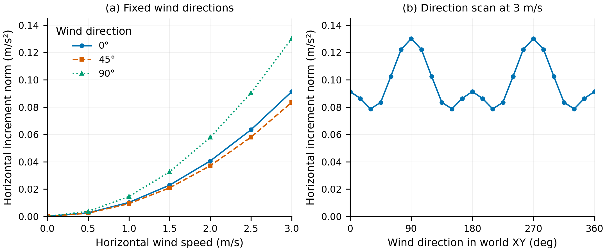

# X4-950 简化气动参考 v1：Task 1–2 检查记录

日期：2026-11-10。当前结论：**先保留解析参考作为候选 baseline，暂不训练 PINN。**
本报告记录 Task 1–2 阶段结果。后续已接入可选解析后端，见
[SITL 对照步骤](analytic-wind-sitl-comparison.md)；首轮悬停真实 SITL 已完成，见
[结果与边界](SITL_FIRST_ROUND_2026-11-10.md)，仍无实物气动验证。

## 用途和接口

参考针对默认 X4-950 + Airbot Play、XML 初始臂/夹爪姿态、无新增载荷。
输入为根点 O 的世界系速度、WXYZ 机体到世界姿态、机体系角速度和世界系水平风。
O 是 `quadrotor_950_pos` 原点，与初始整机质心不同。

`reference_wrench_body(v_air_body, omega_body, reference)` 支持批量计算，
返回完整机体系参考合力 N、关于 O 的诊断力矩 N·m。
`paired_wind_labels(v_world, quaternion_wxyz, omega_body, wind_world, reference)`
在同一状态下计算两次完整参考力，并返回世界系水平风增量加速度：

```text
u_j = Q_j.T @ (R_WB.T @ (v_O_world - wind_world) + omega_body × r_j)
f_j_local = -0.5 * rho * Cd_axes * area_axes * u_j * abs(u_j)
F_body = sum(Q_j @ f_j_local)
tau_O_body = sum(r_j × (Q_j @ f_j_local))
label_world = diag(1, 1, 0) @ (F_world_wind - F_world_no_wind) / mass_total
```

标量阻力依据 [NASA Glenn 阻力方程](https://www1.grc.nasa.gov/beginners-guide-to-aeronautics/drag-equation/)。
逐部件、逐轴应用和椭球轴向面积是本项目的近似选择。
`rho=1.225 kg/m³`、逐轴 `Cd=1.0` 明确为假设，不能由 XML 唯一识别。
完整三轴力可有 Z 分量；输出风标签 Z 精确为零，力矩只作诊断。
完整阻力满足 `F·v_air + tau_O·omega ≤ 0`；不要求风增量满足此不等式。

风输入合模长限制为 0–3 m/s、Z=0；`[3,3,0]` 会拒绝。
这是风速限制，不是相对空气速度限制，逆向运动时允许相对来流达到约 6 m/s。
参考没有网络归一化器、Hummingbird 参数、RPM、EMA 或限幅依赖。

## XML 与几何冻结

事实来自 MuJoCo 3.6.0 在 scratch `MjData` 中对 `qpos0` 的编译和前向计算：

| 项目 | 结果 |
| --- | --- |
| 机身惯性体质量 | 6.5 kg |
| 含机械臂整机质量 | 8.0004 kg |
| 初始质心相对 O | 约 `[0,0,-0.05872472] m` |
| 初始姿态刚性聚合惯量 | 与既有 XML 审计一致；不替代多体惯量 |
| 推力 site | rotor0–3，XY=±0.3358757 m、Z=0.065 m |
| XML 单电机硬限 | 61.2915625 N |
| 当前桥接满量程 | 39.241962 N/电机，来自整机质量与 MPC_THR_HOVER=0.5 |
| 原始流体设置 | density=0、viscosity=0；未启用 MuJoCo 流体力 |
| 源依赖 | 实际 include 闭包 11 份 XML；实际被 geom 引用的 mesh 18 份 |
| 去重代理 | 29 个；每个源 geom 最多选择一次，其余列明排除原因 |

代理选择如下：

| 部件 | 数量 | 方法 |
| --- | --- | --- |
| 中心电池体/飞控体 | 2 | 各自 collision box 半尺寸 |
| 电机壳 | 4 | cylinder → `[radius,radius,half_length]` |
| 机臂 | 4 | capsule → `[radius,radius,half_length+radius]` |
| 起落架滑橇/支腿 | 6 | 同上；保留各段局部轴方向 |
| chassis 小接触件 | 4 | 各自 cylinder，未并入滑橇 |
| arm_base、link2、link3、link6、left、right | 6 | 每个 body 的 collision union AABB，合并后只计一次 |
| link1、link4、link5 | 3 | 无 collision 时，由 visual mesh 的 body-frame 顶点包围尺寸派生单一 AABB |

每个代理记录源 geom ID/名称、mesh 名称、质量所属 body、中心、方向、半轴、
`A_i=pi*r_j*r_k` 面积、派生方法及理由；详见导出的 `geometry_manifest.json`。
mesh 顶点通过编译 geom 的姿态/偏移恢复到 body frame，已用原始 link1 OBJ 顶点核对。
源 mesh 的 scale、资产路径和转换以 [MuJoCo 3.6 MJCF](https://mujoco.readthedocs.io/en/3.6.0/XMLreference.html) 为依据。

整机 visual mesh、机械臂重复 visual、旋转桨叶 visual、四个 `thruster-*` 碰撞盘、
floor、site、camera 均不累计为代理。未使用的 cabinet XML 和 camera_stand mesh 不冒充实际引用依赖。
不新增锁臂或改 XML；“固定”只指参考几何，在未来闭环中仍须记录真实关节偏离。

**几何限制：** 去重解决 visual/collision 的重复计数，但没有计算遮挡、
部件接合处的体积重叠或尾流；collision 代理也可能遗漏实物细节。
因此它是可审查的仿真假设，不能视作真实迎风面积或气动辨识。

## 离线检查结果

手算测试覆盖阻力符号、量纲/二次缩放、零运动、`omega×r` 点速度、
局部轴旋转、合力/力矩、根点与质心区分、WXYZ 坐标转换、批量与标量一致性、
完整阻力耗散性、精确零风增量、风域/非有限输入拒绝及输入状态不被修改。

seed=42 的 512 个状态检查：根点水平速度 ≤3 m/s、垂直速度 ±1 m/s、
roll/pitch ±20°、yaw 全方向、角速度合模长 ≤1.5 rad/s、水平风 ≤3 m/s。
这些范围是离线检查域，不是已验证飞行包线。
另有静止状态的 7 个风速 ×24 个风向扫描，以及速度 -3X、风 +3X 的边界例。
扫描仅作检查，不是 Task 3 的 pilot、正式训练集或飞行轨迹采集。

| 检查 | 本次结果 |
| --- | --- |
| 零风最大标签幅值 | 精确 0 m/s² |
| 标签 Z 最大绝对值 | 精确 0 m/s² |
| 512 个完整阻力功率检查的最大值 | -0.0399092 W；均 ≤0 |
| 随机状态水平增量范数 | 0.001942–0.324104 m/s²，非全域上界 |
| 3 m/s +X 静止风增量 | 约 `[0.091363,0,0] m/s²` |
| 3 m/s +Y 静止风增量 | 约 `[0,0.130215,0] m/s²` |
| 速度 -3X、风 +3X 的增量 | 约 `[0.274089,0,0] m/s²` |



图中每个点是一次确定性参考计算，线连接有序条件，无统计误差棒。
二次增长和方向差异由所选逐轴模型及冻结几何产生，不能推断为真实飞机的测量规律；
尤其不能强制当前整机具有 X/Y 或 C4 对称性。
同时提供 [PDF](figures/x4-950-reference-v1.pdf) 和 [SVG](figures/x4-950-reference-v1.svg)。

## 计算成本与 PINN 决策

本机 Python 3.12.13、NumPy 2.4.4、CPU float64；20 次预热后测 1,000 次单状态配对，
包含每次配置/输入校验、完整有风/无风求力和坐标转换，不含模型加载/图形/PX4。
初次测得中位数 **457.81 μs**、P95 **478.21 μs**、P99 **492.74 μs**；
512 状态批量配对中位总耗时 7.81 ms，约 15.25 μs/状态。
耗时受负载影响；可复现命令的最新测量在 `reference_check.json`，不作最坏情况保证。

相较当前 XML 5 ms 步长，这个解析计算值得直接用作后续仿真候选，
当时没有测得需要 PINN 的速度或接口收益，因此未进入后续训练。
最新状态是 **Task 3–4 仍未执行，Task 5–6 仅解析接入/离线部分已完成**，
没有生成 3,000/120,000 对训练数据、训练模型、覆盖旧权重或切换默认。
训练代理只能近似这套参考，不能补足未知的真实 Cd、旋翼诱导流与部件干扰。
下一步仍需验证解析参考的闭环成本和表现；只有出现具体瓶颈或新增建模需要，
才重新定义可验证的代理训练目标。

## 复现与文件

在项目根目录执行：

```bash
/home/raids/miniconda3/envs/env_uav/bin/python scripts/export_x4_950_parameters.py
/home/raids/miniconda3/envs/env_uav/bin/python scripts/check_x4_950_reference.py
MPLCONFIGDIR=/tmp/x4-mpl-cache /home/raids/miniconda3/envs/env_uav/bin/python scripts/plot_x4_950_reference.py
PYTEST_DISABLE_PLUGIN_AUTOLOAD=1 MPLBACKEND=Agg /home/raids/miniconda3/envs/env_uav/bin/python -m pytest -q
```

声明配置：[configs/pinn/x4_950_reference_v1.json](../configs/pinn/x4_950_reference_v1.json)。
产物目录：[outputs/pinn/x4_950_wind_v1](../outputs/pinn/x4_950_wind_v1)：
`vehicle_parameters.json`、`geometry_manifest.json`、`reference_config.json`、`reference_check.json`。
输出目录沿用项目 Git 忽略策略，需按命令重建；不要仅复制截图代替冻结配置。
检查入口核对 reference/vehicle/geometry 指纹和当前 XML/mesh 内容；版本变化时拒绝沿用旧产物。

最终离线全量为 **167 passed in 18.72s**，其中新增 31 项。
Task 1–2 阶段没有启动真实 SITL；后续首轮证据见上述链接，不代表全包线、GUI 或实物验证。
运行时原 PINN、模型/XML、PX4 和运行参数保留。

## 执行记录

- 基线：136 passed in 16.55s。
- Task 1：完成；参数/几何/散列及 CLI 检查 8 passed in 1.97s。
- Task 2：完成；新增参考性质与检查入口，全量 167 passed in 18.75s。
- 工作目录没有 Git 元数据；按用户指定原地开发，不初始化 Git，也不执行工作树/提交脚本。
- Task 1 → Task 2 接口：自包含 reference JSON 携带相同整机质量、冻结代理、初始关节和来源指纹；未引入旧网络依赖。
- 解析参考先检查、后判断训练必要性；当前不进入训练。用户授权范围已由既有设计及本次 Task 1–2 请求明确。

- 独立只读审阅：无阻塞缺陷。12 个多维批量样本与逐部件循环对照，合力差≤2.22e-16 N、力矩差≤1.11e-16 N·m。
- 审阅未判断的实物精度、几何保真、旋翼/遮挡误差及 SITL 闭环均保留为未验证边界；当前数据不能支持这些结论。
- 最终复核：167 passed in 18.72s；既有审计的 12 份 XML 全部保持原散列，新增文档相对链接有效，检查报告的实现散列与当前代码一致。
